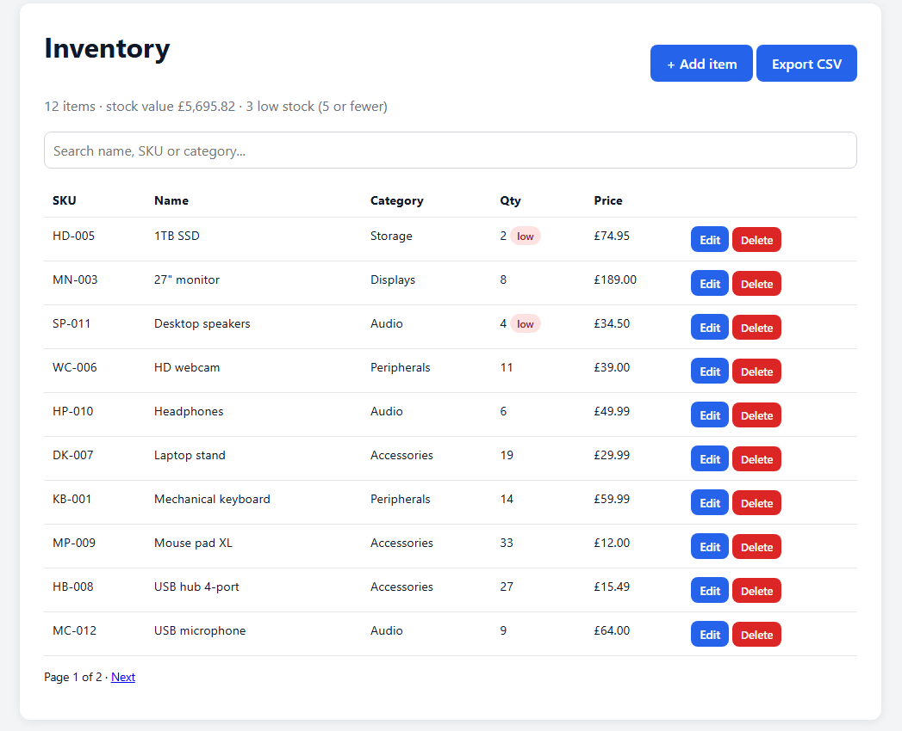
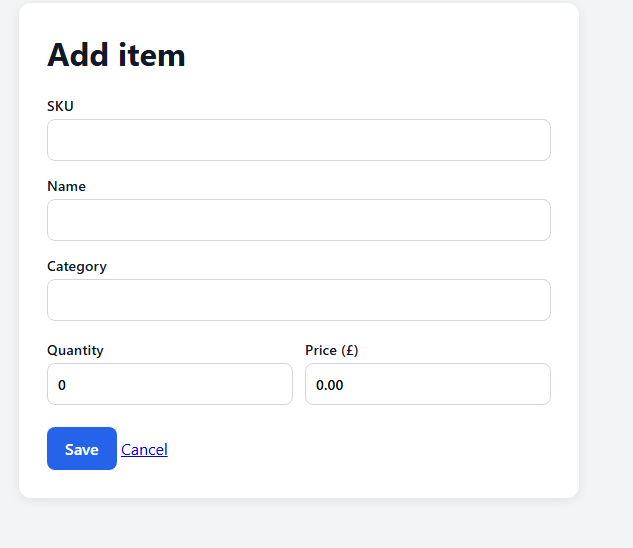
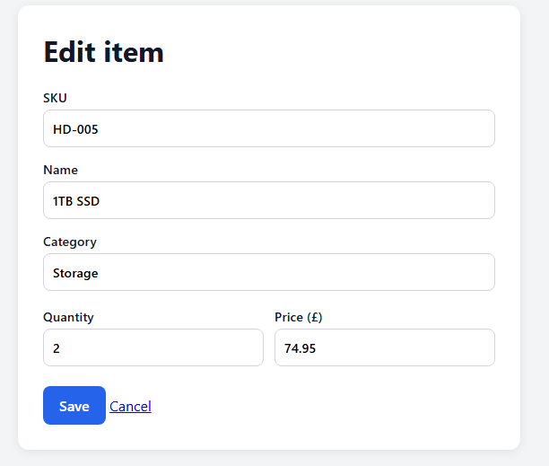

# Inventory Manager (PHP + MySQL)

A compact CRUD app for managing stock: add, edit, delete, search, paginate and export items to CSV.
## Screenshots



## Features
- Full create / read / update / delete with server-side validation
- Search across name, SKU and category, with pagination
- Dashboard summary: item count, total stock value, low-stock count
- CSV export (respects the current search) with spreadsheet formula-injection protection
- PDO prepared statements, output escaping, CSRF protection, unique SKU handling
- No frameworks; runs on SQLite out of the box or on MySQL/MariaDB

## Run it locally
```bash
git clone <your-repo-url>
cd inventory-manager
php seed.php        # optional: adds demo data (SQLite)
php -S localhost:8000
```
Open http://localhost:8000.

### Use MySQL / MariaDB
Import `schema.mysql.sql`, then:
```bash
export DB_DRIVER=mysql DB_HOST=127.0.0.1 DB_NAME=inventory_demo DB_USER=root DB_PASS=yourpassword
php -S localhost:8000
```
(`seed.php` is SQLite-only; for MySQL add your own rows.)

> This demo has no login. For real use, add authentication (see the booking-system project for an example).

## Structure
```
index.php   list, search, pagination, stats
edit.php    add / edit form with validation
delete.php  delete (POST + CSRF)
export.php  CSV download
db.php      connection (SQLite or MySQL)
```
